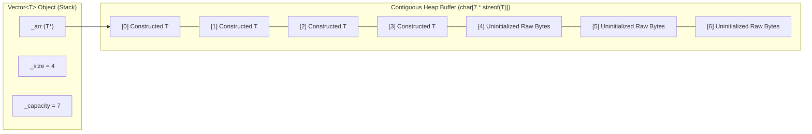

# Vector — Custom STL-Compatible Dynamic Array in C++


A header-only generic C++ implementation of a dynamically resizing contiguous array (`Vector<T>`), developed as part of a university **Data Structures** course. The container is designed to mirror the interface, memory model, object lifetime guarantees, and asymptotic time complexities of `std::vector` from the C++ Standard Template Library (STL).

---

## Table of Contents

- [Overview](#overview)
- [Key Technical Features](#key-technical-features)
- [Memory Model & Internal Architecture](#memory-model--internal-architecture)
- [Project Structure](#project-structure)
- [API Reference & Complexity](#api-reference--complexity)
- [Code Examples](#code-examples)
- [Test Suite (TDD)](#test-suite-tdd)
- [Building & Running](#building--running)
- [Implementation Notes & STL Comparison](#implementation-notes--stl-comparison)
- [Author](#author)

---

## Overview

Implementing `std::vector` from scratch requires solving several low-level C++ resource management challenges beyond a simple wrapper around `new T[]`. A production-style dynamic vector must separate **raw memory allocation** from **object construction** and **destruction** so that:
1. Unused capacity does not default-construct objects prematurely.
2. Types **without a default constructor** can be stored and reallocated.
3. **Move-only types** (types with deleted copy constructors) can be emplaced and moved across buffer reallocations.
4. Destructors are invoked deterministically when elements are removed (`pop_back`, `clear`, `resize`, or container destruction) without double-freeing raw storage.

This project implements `Vector<T>` in [`Vector/Vector.h`](Vector/Vector.h) and validates every behavior incrementally across **16 automated unit test suites** in [`Vector/Tests/`](Vector/Tests/).

---

## Key Technical Features

- **Decoupled Allocation & Placement Construction**
  - Raw storage is allocated as an uninitialized byte array:
    ```cpp
    reinterpret_cast<T*>(new char[capacity * sizeof(T)])
    ```
  - Elements are constructed in-place via **placement `new`**:
    ```cpp
    new(_arr + _size++) T(std::forward<Args>(args)...);
    ```
  - Elements are destroyed explicitly via `_arr[i].~T()` before raw storage is released via `delete[] reinterpret_cast<char*>(_arr)`.
- **Full Rule of Five Compliance**
  - Implements a custom **Destructor**, **Copy Constructor**, **Copy Assignment Operator** (with self-assignment protection), **`noexcept` Move Constructor**, and **`noexcept` Move Assignment Operator**.
- **Move Semantics & Perfect Forwarding**
  - Variadic `emplace_back(Args&&... args)` forwards constructor arguments directly into uninitialized buffer slots using `std::forward`.
  - Reallocation transfers existing elements into the new buffer using `new(temp + i) T(std::move(_arr[i]))`, enabling full compatibility with non-copyable types.
- **Amortized $O(1)$ Insertion**
  - Uses a geometric growth progression (`newCapacity = 2 * _capacity + 1`, expanding `0 -> 1 -> 3 -> 7 -> 15 -> 31 -> ...`) when capacity is exhausted.
- **Bounds Checking & Debugging Support**
  - `at(index)` performs runtime bounds checking and throws `std::invalid_argument("Index out of range")` on out-of-bounds indices.
  - `operator[](index)` provides unchecked fast access in release builds while enforcing `assert(index < _size)` in debug builds.

---

## Memory Model & Internal Architecture

`Vector<T>` maintains three private data members:
- `_arr` (`T*`): Pointer to the contiguous heap-allocated raw byte buffer.
- `_size` (`size_t`): Number of currently constructed active elements in `[0, _size)`.
- `_capacity` (`size_t`): Total number of `T`-sized slots allocated in `[0, _capacity)`.



### Buffer Reallocation Flow (`resize`)

When `push_back`, `emplace_back`, `reserve`, or `shrink_to_fit` triggers a reallocation to `newSize`:
1. A new raw buffer `temp` of `newSize * sizeof(T)` bytes is allocated.
2. If shrinking (`_size > newSize`), excess elements `[newSize, _size)` have their destructors (`~T()`) called explicitly and `_size` is clamped to `newSize`.
3. Active elements `[0, _size)` are move-constructed into `temp` via `new(temp + i) T(std::move(_arr[i]))`, and their old instances in `_arr[i]` are destroyed via `_arr[i].~T()`.
4. The old raw byte buffer is freed via `delete[] reinterpret_cast<char*>(_arr)` and `_arr` is updated to `temp`.

---

## Project Structure

```text
Vector/
├── Vector.sln                                                   # Visual Studio 2022 Solution
├── .gitignore                                                   # Visual Studio & build artifact ignores
├── README.md                                                    # Project documentation
│
└── Vector/
    ├── Vector.h                                                 # Generic Vector<T> class template & implementation
    ├── main.cpp                                                 # Test runner entry point
    ├── Vector.vcxproj                                           # MSVC C++ project configuration (v143)
    ├── Vector.vcxproj.filters                                   # Solution Explorer filters
    │
    └── Tests/                                                   # 16 Incremental TDD Test Suites
        ├── 1BasicConstructorsTest.h                             # Default, sized, and fill constructors
        ├── 2InitializerListConstructorTest.h                    # std::initializer_list<T> constructor
        ├── 3PushBackTest.h                                      # push_back() and automatic capacity growth
        ├── 4PopBackTest.h                                       # pop_back() and size decrement
        ├── 5ClearTest.h                                         # clear() and empty() verification
        ├── 6CopyConstructorTest.h                               # Deep copy construction & independence
        ├── 7AssignmentOperatorTest.h                            # Copy assignment & self-assignment safety
        ├── 8AccessFunctionsTest.h                               # at(), front(), back(), and data()
        ├── 9ReserveAndShrinkToFitTest.h                         # reserve() and shrink_to_fit() capacity transitions
        ├── 10SwapTest.h                                         # O(1) member swap()
        ├── 11SubscriptOperatorTest.h                            # Mutable and const operator[] overload resolution
        ├── 12DestructorCallTest.h                               # Exact destructor call counting & leak verification
        ├── 13EmplaceBackTest.h                                  # Variadic emplace_back() with multiple overloads
        ├── 14ClassWithoutDefaultConstructorTest.h               # Support for non-default-constructible types
        ├── 15ClassWithoutCopyConstructorTest.h                  # Support for move-only (non-copyable) types
        ├── 16MoveConstructorAndMoveAssignmentOperatorTest.h     # Move constructor & move assignment operator
        └── Fixtures/
            ├── CustomAsserts.h                                  # Template assertion helpers (assertEqual, assertGreater, assertLess)
            └── CustomAsserts.cpp                                # Boolean assertion implementation (assertBool)
```

---

## API Reference & Complexity

### Constructors, Destructor & Assignment

| Member | Signature | Time Complexity | Description |
| :--- | :--- | :---: | :--- |
| **Default / Sized Ctor** | `Vector(size_t size = 0)` | $O(N)$ | Allocates zero-initialized storage for `size` elements and sets `_size = _capacity = size`. |
| **Fill Ctor** | `Vector(size_t size, const T& val)` | $O(N)$ | Allocates storage for `size` elements and assigns `val` to each slot. |
| **Initializer List Ctor** | `Vector(std::initializer_list<T> initList)` | $O(N)$ | Initializes the vector with the contents of `initList`. |
| **Copy Ctor** | `Vector(const Vector& other)` | $O(N)$ | Performs a deep copy of `other`. |
| **Move Ctor** | `Vector(Vector&& other) noexcept` | $O(1)$ | Transfers buffer ownership from `other` and resets `other` to empty (`nullptr`). |
| **Destructor** | `~Vector()` | $O(N)$ | Invokes `~T()` on all `_size` active elements and deallocates the raw byte buffer. |
| **Copy Assignment** | `Vector& operator=(const Vector<T>& source)` | $O(N + M)$ | Destroys current elements, reallocates storage, and deep-copies `source` (self-assignment safe). |
| **Move Assignment** | `Vector& operator=(Vector&& source) noexcept` | $O(N)$ | Destroys current elements and steals buffer pointers from `source` in $O(1)$ after cleanup. |

### Element Access

| Method | Signature | Time Complexity | Description |
| :--- | :--- | :---: | :--- |
| `operator[]` | `T& operator[](size_t index)`<br>`const T& operator[](size_t index) const` | $O(1)$ | Returns reference to element at `index` (asserts `index < _size` in debug builds). |
| `at` | `T& at(size_t index)`<br>`const T& at(size_t index) const` | $O(1)$ | Bounds-checked access; throws `std::invalid_argument` if `index >= _size`. |
| `front` | `T& front()` / `const T& front() const` | $O(1)$ | Returns a reference to the first element (`_arr[0]`). |
| `back` | `T& back()` / `const T& back() const` | $O(1)$ | Returns a reference to the last element (`_arr[_size - 1]`). |
| `data` | `T* data()` / `const T* data() const` | $O(1)$ | Returns a direct pointer to the underlying contiguous array (`_arr`). |

### Capacity & Modifiers

| Method | Signature | Time Complexity | Description |
| :--- | :--- | :---: | :--- |
| `size` | `size_t size() const` | $O(1)$ | Returns the number of active elements (`_size`). |
| `capacity` | `size_t capacity() const` | $O(1)$ | Returns the current allocated storage capacity (`_capacity`). |
| `empty` | `bool empty() const` | $O(1)$ | Returns `true` if `_size == 0`, otherwise `false`. |
| `reserve` | `void reserve(size_t newCapacity)` | $O(N)$ | Increases capacity to `newCapacity` if `newCapacity > _capacity`. |
| `shrink_to_fit` | `void shrink_to_fit()` | $O(N)$ | Reduces `_capacity` to match `_size` by reallocating the buffer. |
| `push_back` | `void push_back(const T& val)` | $O(1)$ amortized | Appends `val` to the end, expanding capacity to `2 * _capacity + 1` if full. |
| `emplace_back` | `template <typename... Args>`<br>`void emplace_back(Args&&... args)` | $O(1)$ amortized | Constructs an element in-place at the end using placement `new` and perfect forwarding. |
| `pop_back` | `void pop_back()` | $O(1)$ | Decrements `_size` and explicitly invokes the destructor of the removed element. |
| `resize` | `void resize(size_t newSize)` | $O(N)$ | Reallocates buffer to `newSize`, destroying excess elements if shrinking and moving existing ones. |
| `clear` | `void clear()` | $O(N)$ | Explicitly invokes `~T()` on all elements and sets `_size = 0` without freeing capacity. |
| `swap` | `void swap(Vector& other)` | $O(1)$ | Exchanges `_arr`, `_size`, and `_capacity` between two vectors without copying elements. |

### Non-Member Operators

| Operator | Signature | Time Complexity | Description |
| :--- | :--- | :---: | :--- |
| `operator==` | `bool operator==(const Vector<U>& lhs, const Vector<U>& rhs)` | $O(N)$ | Returns `true` if both vectors have equal size and all corresponding elements compare equal. |
| `operator!=` | `bool operator!=(const Vector<T>& lhs, const Vector<T>& rhs)` | $O(N)$ | Returns `!(lhs == rhs)`. |

---

## Code Examples

### 1. Basic Operations & Capacity Management

```cpp
#include "Vector/Vector.h"
#include <iostream>

int main()
{
    Vector<int> vec = { 1, 2, 3 };
    vec.reserve(10);

    vec.push_back(4);
    vec.front() = 10;
    vec.at(2) = 30;

    for (size_t i = 0; i < vec.size(); ++i)
        std::cout << vec[i] << " "; // Output: 10 2 30 4

    vec.shrink_to_fit(); // capacity becomes 4
    return 0;
}
```

### 2. Move-Only & Non-Default-Constructible Types with `emplace_back`

```cpp
#include "Vector/Vector.h"
#include <utility>

struct Resource
{
    int id;
    double weight;

    // No default constructor
    Resource(int id, double weight) : id(id), weight(weight) {}

    // Non-copyable (Move-Only)
    Resource(const Resource&) = delete;
    Resource(Resource&& other) noexcept : id(other.id), weight(other.weight) {}
};

int main()
{
    Vector<Resource> resources;

    // In-place construction via perfect forwarding
    resources.emplace_back(1, 3.14);
    resources.emplace_back(2, 2.71);

    // Move construction transfers ownership in O(1)
    Vector<Resource> movedResources(std::move(resources));
    return 0;
}
```

---

## Test Suite (TDD)

The repository was developed incrementally using **Test-Driven Development (TDD)** across 16 test suites located in [`Vector/Tests/`](Vector/Tests/).

### Static Initialization Test Architecture

Each test header defines a test fixture struct inside `namespace test` and declares a `static` file-scope instance of that struct. When the binary starts, all 16 test suites execute automatically during **C++ static initialization** prior to entering `main()`. Assertions are verified through [`CustomAsserts.h`](Vector/Tests/Fixtures/CustomAsserts.h) (`assertEqual`, `assertGreater`, `assertLess`, `assertBool`), which report the exact file, line number, expected value, and actual value to `std::cerr` if any check fails.

| # | Test File | Verified Behavior |
| :-: | :--- | :--- |
| **1** | [`1BasicConstructorsTest.h`](Vector/Tests/1BasicConstructorsTest.h) | Default `Vector()`, sized `Vector(10)`, and value-filled `Vector(30, 'x')` constructors. |
| **2** | [`2InitializerListConstructorTest.h`](Vector/Tests/2InitializerListConstructorTest.h) | Construction from brace-enclosed `std::initializer_list<T>`. |
| **3** | [`3PushBackTest.h`](Vector/Tests/3PushBackTest.h) | Sequential and loop-based `push_back()` insertions across multiple buffer reallocations. |
| **4** | [`4PopBackTest.h`](Vector/Tests/4PopBackTest.h) | Removing the trailing element with `pop_back()` and verifying remaining elements. |
| **5** | [`5ClearTest.h`](Vector/Tests/5ClearTest.h) | Clearing populated vectors via `clear()` and checking `empty()`. |
| **6** | [`6CopyConstructorTest.h`](Vector/Tests/6CopyConstructorTest.h) | Deep copy construction (`Vector<int> vec2(vec1)`), `operator==`, `operator!=`, and mutation isolation. |
| **7** | [`7AssignmentOperatorTest.h`](Vector/Tests/7AssignmentOperatorTest.h) | Copy assignment (`vec2 = vec1`) and self-assignment (`vec2 = vec2`) correctness. |
| **8** | [`8AccessFunctionsTest.h`](Vector/Tests/8AccessFunctionsTest.h) | Reading and mutating elements via `at()`, `front()`, `back()`, and raw pointer `data()`. |
| **9** | [`9ReserveAndShrinkToFitTest.h`](Vector/Tests/9ReserveAndShrinkToFitTest.h) | Pre-allocating capacity with `reserve(100)` and reclaiming unused memory with `shrink_to_fit()`. |
| **10** | [`10SwapTest.h`](Vector/Tests/10SwapTest.h) | Constant-time buffer and size exchange via `vec1.swap(vec2)`. |
| **11** | [`11SubscriptOperatorTest.h`](Vector/Tests/11SubscriptOperatorTest.h) | Non-const vs. `const` overload resolution for `operator[]`. |
| **12** | [`12DestructorCallTest.h`](Vector/Tests/12DestructorCallTest.h) | Instrumentation counter validating exact destructor calls (`~T()`) on scope exit and reallocations. |
| **13** | [`13EmplaceBackTest.h`](Vector/Tests/13EmplaceBackTest.h) | Variadic `emplace_back()` forwarding 0, 2, and 3 constructor arguments. |
| **14** | [`14ClassWithoutDefaultConstructorTest.h`](Vector/Tests/14ClassWithoutDefaultConstructorTest.h) | Storing, emplacing, pushing, and reserving types that have no default constructor. |
| **15** | [`15ClassWithoutCopyConstructorTest.h`](Vector/Tests/15ClassWithoutCopyConstructorTest.h) | Emplacing and reallocating 100 instances of a class with `= delete` copy constructor. |
| **16** | [`16MoveConstructorAndMoveAssignmentOperatorTest.h`](Vector/Tests/16MoveConstructorAndMoveAssignmentOperatorTest.h) | `Vector( std::move(vec1) )` and `vec1 = std::move(vec2)` with move-only element types. |

---

## Building & Running

### Option 1: Visual Studio 2022 (Recommended on Windows)

1. Clone the repository:
   ```bash
   git clone https://github.com/DavitBakh/Vector.git
   cd Vector
   ```
2. Open `Vector.sln` in **Visual Studio 2022**.
3. Select your desired configuration (**Debug** or **Release**) and platform (**x64** or **Win32**).
4. Build the solution (`Ctrl + Shift + B`) and run without debugging (`Ctrl + F5`).

### Option 2: Command-Line Compilation (MSVC / GCC / Clang)

From the root of the repository, compile `Vector/main.cpp` and `Vector/Tests/Fixtures/CustomAsserts.cpp`:

**MSVC (Developer PowerShell / Command Prompt):**
```powershell
cl /EHsc /std:c++20 /W3 Vector\main.cpp Vector\Tests\Fixtures\CustomAsserts.cpp /Fe:vector_tests.exe
.\vector_tests.exe
```

**GCC / Clang:**
```bash
g++ -std=c++20 -Wall -Wextra Vector/main.cpp Vector/Tests/Fixtures/CustomAsserts.cpp -o vector_tests
./vector_tests
```

**Expected Output:**
```text
All tests passed!
```

---

## Implementation Notes & STL Comparison

While `Vector<T>` closely follows `std::vector<T>`, a few coursework-specific design choices are worth noting:
- **Exception Type in `at()`**: Throws `std::invalid_argument("Index out of range")` when `index >= _size` (whereas `std::vector::at` throws `std::out_of_range`).
- **Role of `resize(newSize)`**: In this implementation, `resize(size_t newSize)` serves as the core buffer reallocation method used internally by `push_back()`, `emplace_back()`, `reserve()`, and `shrink_to_fit()`. When `newSize > _size`, it expands `_capacity` to `newSize` while keeping `_size` unchanged; when `newSize < _size`, it destroys elements in `[newSize, _size)` and shrinks both `_size` and `_capacity` to `newSize`.
- **Growth Factor**: Capacity expands via `2 * _capacity + 1` (ensuring a `0`-capacity vector grows to `1` on the first insertion without a separate branch).

---

## Author

- **Davit Bakhshyan** — [@DavitBakh](https://github.com/DavitBakh)
